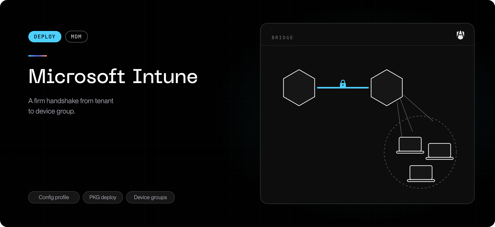
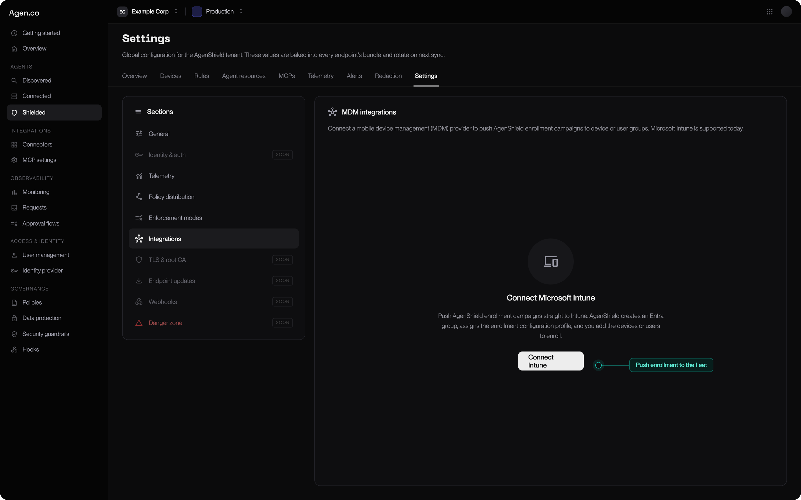
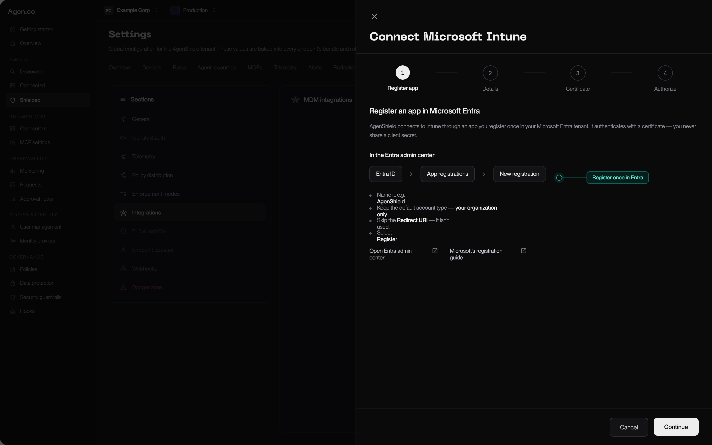

Intune is the MDM AgenShield connects to directly. Connect your Microsoft
Entra tenant once and deploy campaigns from the Frontegg Portal. macOS and
Windows use different installation and configuration objects; see
[Windows deployment](#windows-deployment) for Windows prerequisites and manual
setup.

<Columns cols={2}>
  <Card title="Connected (recommended)" icon="plug">
    Register one Entra app. AgenShield creates the group, the profile, the installer app, and the offboarding script for you — and can repair them if they drift.
  </Card>
  <Card title="Manual upload" icon="download">
    Download the campaign's profile and package and push them yourself. Fully supported, no tenant connection.
  </Card>
</Columns>

## Connected integration

You do four things once — register an app, hand over two IDs, upload a
certificate, grant permissions — and from then on every campaign deploys with
one click from the Frontegg Portal.

## What AgenShield does on your behalf

Once connected, pushing a campaign creates and maintains these objects in your
tenant:

| Object                        | Purpose                                                                                                                          |
| ----------------------------- | -------------------------------------------------------------------------------------------------------------------------------- |
| **Entra security group**      | One per campaign; membership targets deployment                                                                                  |
| **Configuration profiles**    | macOS approvals and enrollment; shared Windows policy definitions plus a separate enrollment policy per campaign where available |
| **Installer apps**            | A shared installer app per platform and connection, assigned to campaign groups                                                  |
| **Uninstall scripts + group** | Shared offboarding objects for the supported platforms                                                                           |

Your side of the deal is one thing: **put devices or users in the group** —
always with **Assign members** in the Frontegg Portal, including when you bring
back a device you offboarded earlier. Adding members there first takes each one
out of the `AgenShield — Uninstall` offboarding group and refuses one that
already belongs to another campaign's group (see
[One device, one campaign](#one-device-one-campaign)). A device added directly
in Entra or Intune skips both steps: if it is still in `AgenShield — Uninstall`
from an earlier offboarding, the uninstall script assigned to that group
uninstalls AgenShield from it again.

<Note>
  **The profile pairing below is for macOS.** Connected macOS push deploys the
  all-in-one profile and package. Windows uses its own enrollment profile and
  installer app; do not upload a macOS profile to Windows. To push macOS
  objects yourself, use [Manual upload](#manual-upload).

Mixing the two is what to avoid, and the rule is per device: **one profile and
one installer.** Never both profiles (they carry the same payloads, and a
duplicate network-filter payload resolves unpredictably), and never both the
package and the install command.

The pairing is not free in both directions. The **install command** works with
either profile, because it carries the enrollment token itself. The **package**
requires `agenshield.mobileconfig`: it has no other way to receive a token, and
`deployment.mobileconfig` does not carry one — see
[Choosing a profile](#choosing-a-profile).

</Note>

## Connect your tenant

**Settings → Integrations → Connect Microsoft Intune.** The wizard has four
steps and takes about five minutes. AgenShield authenticates with a
**certificate it generates** — you never create, paste, or rotate a client
secret.

<Frame caption="Settings → Integrations — where the connection starts and where its health is reported afterwards.">
  
</Frame>

### 1. Register an app in Entra

In the Entra admin center: **Entra ID → App registrations → New registration.**

- Name it something recognisable, e.g. `AgenShield`.
- Keep the default account type — **your organization only**.
- Skip the redirect URI. It is not used.
- Select **Register**.

<Frame caption="The wizard mirrors the Entra steps as you go — register once, then hand the two IDs back.">
  
</Frame>

### 2. Give AgenShield the app's identifiers

Back in the wizard, enter a name for the connection plus the two GUIDs from your
new app registration's overview page:

| Field                       | Where to find it          |
| --------------------------- | ------------------------- |
| **Directory (tenant) ID**   | App registration overview |
| **Application (client) ID** | App registration overview |

### 3. Upload the certificate

AgenShield generates a keypair, keeps the private key encrypted, and hands you
the public half. Download it, then in your app registration go to
**Certificates & secrets → Certificates → Upload certificate** and add the file.

The wizard shows the **SHA-1 thumbprint** Entra will display after upload —
compare the two to confirm you uploaded the right file to the right app.

### 4. Add permissions and grant consent

**API permissions → Add a permission → Microsoft Graph → Application
permissions.**

<Warning>
  Pick the **Application permissions** tile. **Delegated** — the tab Entra opens
  first — will not work: AgenShield runs with no signed-in user, and the
  connection test fails with a Microsoft "UnknownError" if the permissions were
  added as Delegated. This is the single most common setup mistake.
</Warning>

**Required.** The connection test probes each of these individually, so a
failure tells you exactly which one is missing.

| Permission                                    | What it is for                                                                               |
| --------------------------------------------- | -------------------------------------------------------------------------------------------- |
| `DeviceManagementConfiguration.ReadWrite.All` | Creates the campaign's configuration profile and assigns it. Also proves your Intune license |
| `DeviceManagementApps.ReadWrite.All`          | Publishes the installer package as an Intune app — this is what installs AgenShield          |
| `DeviceManagementScripts.ReadWrite.All`       | Creates the uninstall script used for offboarding                                            |
| `Group.ReadWrite.All`                         | Creates the campaign and offboarding groups and manages their membership                     |

<Accordion title="Optional permissions — three Frontegg Portal conveniences, each addable later">
  Each unlocks one specific feature and nothing else. To add one later, append
  the permission and re-run **Grant admin consent** — no reconnection needed.

| Permission                                | Enables                                                                                                           | If you skip it                                                                                                                                                                                |
| ----------------------------------------- | ----------------------------------------------------------------------------------------------------------------- | --------------------------------------------------------------------------------------------------------------------------------------------------------------------------------------------- |
| `Device.Read.All`                         | Browsing your device directory from the Frontegg Portal                                                           | Add devices in Intune or Entra instead, without the Frontegg Portal's membership checks                                                                                                       |
| `User.Read.All`                           | Browsing your users from the Frontegg Portal                                                                      | Manage user-group membership from Intune or Entra instead                                                                                                                                     |
| `DeviceManagementManagedDevices.Read.All` | Rollout progress, matching enrolled devices to their Intune records, and uninstalling a device when you revoke it | Pushes and offboarding still work; the rollout view reports the missing permission. Revoking a device no longer uninstalls it through Intune, and no error is shown: use **Offboard** instead |

</Accordion>

Then select **Grant admin consent for your organization**, confirm, and
**Refresh** — every row must read "Granted". Finally, run the wizard's
connection test.

<Tip>
  Entra propagates consent and certificate changes with a lag, so a test run
  immediately after setup can fail and then pass. AgenShield retries
  automatically before reporting an error. If it still fails, **Settings →
  Integrations** shows a live per-permission status — it names the exact grant
  that is missing rather than making you guess.
</Tip>

## Push a campaign

From **Devices** (on the campaign) or **Settings → Integrations**, choose
**Push to Intune**:

1. Pick the campaign.
2. Name the group — e.g. `AgenShield — Pilot`.
3. Choose whether members will be **devices** or **users**.

AgenShield creates the group, materializes and assigns the applicable campaign
profiles, and assigns the installer apps. It runs in the background; check the
reported result for each platform rather than assuming one platform's success
proves the other.

Then **add members**. Nothing deploys until the group has members — Intune
applies a profile only to members of the group it is assigned to.

<Note>
  Membership changes take a few minutes to reach devices. That is Intune's
  check-in cadence, not AgenShield.
</Note>

### One device, one campaign

A device or user may belong to **only one AgenShield campaign group per
connection**. If you try to add one that is already in another campaign's group,
the whole request is refused and the conflicts are listed — moving a device
between campaigns is a decision, not a side effect. Confirm, and AgenShield
removes it from the other group first.

## Track the rollout

With `DeviceManagementManagedDevices.Read.All` granted, the push view compares
group membership with Intune's inventory and the devices that actually enrolled.
Where Windows rollout is available, review macOS and Windows separately:

| State         | Meaning                                                                       |
| ------------- | ----------------------------------------------------------------------------- |
| **Connected** | AgenShield is enrolled and the device is reporting recently                   |
| **Installed** | An AgenShield installation is matched, but the device has not reported lately |
| **Pending**   | In the group, with no matching AgenShield installation yet                    |

It also lists enrolled devices that are **not** in the group — usually machines
that were installed by script before the MDM push existed.

## Offboard a device

Use **Offboard**, not "remove from group".

<Warning>
  Removing a member from the campaign group does **not** uninstall AgenShield.
  MDMs run scripts when a device is *added* to a group, never when it is
  removed — so a plain removal leaves the software installed and merely
  unmanaged.
</Warning>

Successful offboarding removes the selected member from this connection's install
targeting **before** adding it to the uninstall group, whose assigned script
removes AgenShield at the next check-in. Re-onboarding removes uninstall-group
membership before restoring install targeting.

<Note>
  If offboarding reports conflicting user/device assignments or incomplete
  inventory, it has not established a safe uninstall transition. Have IT remove
  or migrate the relevant other install assignments, resolve the inventory
  access issue where reported, then retry the supported offboarding action.
  Do not remove an entire user from targeting just to offboard one of that
  user's devices. A refused action is not successful uninstall evidence.
</Note>

### Windows offboarding and reinstall timing

On Windows, the uninstall script and the installer app are run by the Intune
Management Extension, which checks in on its own schedule — about every eight
hours, separately from the device's MDM sync. An offboarded device can
therefore keep AgenShield for hours. To make a device check in now, restart the
**Microsoft Intune Management Extension** service on it, for example from an
administrator PowerShell session:

```powershell
Restart-Service -Name IntuneManagementExtension
```

If you add a device back to a campaign within about 24 hours of offboarding
it, Intune may not reinstall AgenShield until the Intune Management Extension's
per-app re-evaluation (GRS) record expires — about 24 hours after the
`AgenShield Installer` app was last processed on that device. Restarting the
Intune Management Extension does not bypass it. Wait for the interval to pass,
or clear the device's cached evaluation of the app by following
[Microsoft's guidance](https://learn.microsoft.com/en-us/answers/questions/1180865/intune-install-apps-how-to-re-run-the-installation).

A reinstalled app is not a re-enrolled device. After AgenShield is reinstalled,
confirm that `agenshield status` reports the device enrolled with the expected
organization and cloud URL, and that the device appears under **Devices** in
the Frontegg Portal and receives your organization's policy. If enrollment is
refused because the device was enrolled before, follow
[Re-enroll a previously enrolled Windows device](#re-enroll-a-previously-enrolled-windows-device).

### Re-enroll a previously enrolled Windows device

Offboarding removes AgenShield from a Windows device, but it does not release
the device's registration with your organization. When AgenShield is installed
on that device again, in the same campaign or another one, enrollment can be
refused: the AgenShield app says **Your organization already holds a
registration for this device**, and `agenshield status` does not report the
device as enrolled. The device keeps retrying, but nothing done on the device
resolves this, including entering a token.

To recover:

1. In the Frontegg Portal, go to **Devices**, find the device's old record, and
   **revoke** it.
2. Check whether revoking also offboarded the device. It does when AgenShield
   can identify the device in Intune and no other active record claims it, as
   described in
   [Revoking a device your MDM manages](../../deployment/devices.mdx#revoking-a-device-your-mdm-manages):
   the device is removed from every AgenShield campaign group on this
   connection and added to the `AgenShield — Uninstall` group, whose script
   removes AgenShield at the next check-in. If the device is now in
   `AgenShield — Uninstall`, promptly add it back to its campaign with
   **Assign members**, which takes it out of the uninstall group.
3. Confirm that the device enrolled again before you consider it done:
   `agenshield status` reports it enrolled with the expected organization and
   cloud URL, the device appears under **Devices** in the Frontegg Portal and
   receives your organization's policy, and, after any required restart,
   `agenshield doctor` shows **Kernel enforcement** as
   `driver loaded and enforcing policy`.

If the uninstall script ran before you added the device back, AgenShield has
been removed again, and the reinstall timing above applies.

## Keep it healthy

Two maintenance actions, both in **Settings → Integrations**:

| Action          | When to use it                                                                                                                                                                                     |
| --------------- | -------------------------------------------------------------------------------------------------------------------------------------------------------------------------------------------------- |
| **Check setup** | Read-only verification of everything the push created — group, profile, installer app, offboarding script. It also confirms the deployed profile still byte-matches the campaign's current profile |
| **Repair**      | Re-runs the push. Recreates anything deleted, renames a renamed group back, refreshes the profile and script to current, and re-asserts assignments                                                |

If someone edits or deletes an AgenShield object in Intune or Entra, **Check
setup** reports it and **Repair** converges it back.

<Note>
  If a revoked campaign still shows **cleanup pending**, use **Retry cleanup**
  where that action is available, rather than repairing an install you revoked.
  Resolve any reported assignment conflict or connection error first. Cleanup
  can partially complete: a blocked or failed retry may have removed some
  deployments while retaining others for a safe later retry. It is not an
  all-or-nothing result and does not prove device uninstall succeeded. Review
  the fully cleaned and remaining deployment counts before treating retained
  objects as removed.
</Note>

The installer apps are shared across campaign groups. Refreshing one does not
update devices that already have AgenShield; see
[Update Windows devices](#update-windows-devices). Use **Check setup** and
**Repair** when the Windows or macOS object reports drift.

## Windows deployment

Windows connected push needs devices that Intune already manages and a Windows
release that includes the Intune assets. Check both once, below, before your
first Windows push. Your environment must also expose the Windows installer
app, enrollment profile, and setup checks; if those objects are not available
in your connection, use [Manual Windows setup](#manual-windows-setup).
Availability of a Windows download alone does not prove Intune delivery has
completed.

### Prepare Intune for Windows enrollment

AgenShield reaches only Windows devices that are enrolled in Intune. A device
that is Entra-joined but not enrolled never receives the app or the profiles,
and does not appear under **Devices → Windows** in Intune. Check once per
tenant:

| Requirement                    | What to check                                                                                                                                                                                                                         |
| ------------------------------ | ------------------------------------------------------------------------------------------------------------------------------------------------------------------------------------------------------------------------------------- |
| **MDM user scope**             | **Devices → Device onboarding → Enrollment → Windows → Automatic Enrollment.** Set **MDM user scope** to **All**, or to **Some** with a group containing the users who sign in to the devices. **None** enrolls nothing automatically |
| **Licensing**                  | Each enrolling user has an Intune license. Automatic enrollment also needs Microsoft Entra ID P1 or P2                                                                                                                                |
| **MFA and Conditional Access** | If Conditional Access requires MFA, an automatic enrollment attempted during a password-only sign-in is refused — Entra's sign-in logs show `AADSTS50076` — and the device stays unenrolled                                           |
| **Enrollment discovery**       | Automatic discovery for a custom sign-in domain needs Microsoft's `EnterpriseEnrollment` DNS record. Without it, enrolling by hand asks for a server address                                                                          |

To enroll a device that missed automatic enrollment, sign in to it as a user in
the MDM user scope and open **Settings → Accounts → Access work or school →
Enroll only in device management**, then complete the MFA prompt. If Windows
asks for a server address, enter
`https://enrollment.manage.microsoft.com/enrollmentserver/discovery.svc`. An
enrolled device shows an **Info** button on its work or school account; without
one, Intune does not manage the device. See Microsoft's guides to
[automatic enrollment](https://learn.microsoft.com/en-us/intune/device-enrollment/windows/enable-automatic-mdm)
and
[enrollment discovery](https://learn.microsoft.com/en-us/intune/device-enrollment/windows/create-cname-autodiscovery).

<Note>
  The MDM user-scope group and the AgenShield campaign group are unrelated. The
  user scope decides which users' devices Intune manages at all; the campaign
  group decides which managed devices receive AgenShield. A device needs both:
  adding it to a campaign group does not enroll it in Intune.
</Note>

### Windows release requirements

Intune delivery takes its Windows assets from the current release on the
Windows release channel used for Intune. That release must include the signed
installer, the bootstrap, and the policy definitions (ADMX and ADML). When it
does not, the connection still reports connected but its test shows a Windows
readiness warning, and a push reports Windows delivery as degraded with:

```text
Windows release <version> on channel "<channel>" is missing MDM assets: installer, bootstrap, admx, adml. Publish a Windows release that includes them, then run Check setup → Repair.
```

The list names only the assets that are missing, and macOS delivery is not
affected. Windows releases are published by Frontegg: contact support with the
version and channel from the message. Once a complete release is available,
run [Check setup and then Repair](#keep-it-healthy) on the push. A failed
Windows delivery is not retried by later pushes on its own.

### What the push creates on Windows

For supported x64 Windows devices, the connected path creates:

- A **Win32 app**, `AgenShield Installer`, shared across the connection and
  assigned as required. It runs a signed, tokenless bootstrap as SYSTEM; the
  device downloads and verifies the MSI.
- A **shared Windows definition profile**, `AgenShield Windows Policy Template`,
  per connection. It ingests the AgenShield ADMX once and is assigned to
  campaign groups.
- A **Windows enrollment profile** per campaign, named after the campaign rather
  than the group: `AgenShield — <campaign name> (Windows)`. It sets only the
  machine enrollment policy, including the token and cloud URL, plus the
  organization label and version pin when provided. It does not ingest another
  ADMX copy. A campaign's version pin applies to Windows as well as macOS.
  Windows and macOS releases are published independently, so pin a version that
  includes a signed Windows installer, or clear the pin. Never bypass installer
  verification.
- A shared Windows uninstall script, `AgenShield (uninstall, Windows)`, for the
  `AgenShield — Uninstall` offboarding group.

Assign the shared definitions, campaign enrollment profile, and app to the same
intended devices. A device already enrolled is not silently moved to another
cloud or campaign.
Do not assign duplicate ADMX definitions at the same URI. Revoking one campaign
removes its enrollment profile, not definitions shared by other campaigns.
Keep one enrollment-policy source per device: do not overlap another Intune
connection's campaign or a manual/GPO enrollment policy on the same devices.
Different profile names do not isolate the machine's enrollment settings.

The Windows app detects the presence of the 64-bit machine `Version` value
under `HKEY_LOCAL_MACHINE\SOFTWARE\AgenShield`. That is an install indicator,
not proof of enrollment, current policy, or active protection. Confirm all of
those on a pilot device before expanding the rollout.

Windows Server is not an Intune enrollment target. Use Intune-supported Windows
11 devices for delivery qualification, and do not count a server-side install
test as proof that the app and profile reached an Intune-managed device.

Your organization's PowerShell and application-control policies still apply.
Where IT enforces `AllSigned`, approve the verified bootstrap signer as a
machine trusted publisher before unattended execution; signature validity
alone is not publisher-trust authorization. The generated non-interactive
command fails rather than waiting for publisher approval. Paste the campaign's
generated commands verbatim, and do not weaken IT policy to make a deployment run.

### What to expect on a device

Intune schedules the app and the configuration profiles independently, so they
can reach a device in either order and tens of minutes apart — longer right
after a group membership change. Installation does not depend on enrollment:

- If the app arrives first, AgenShield installs and waits for its
  configuration. It checks again every few minutes and enrolls on its own once
  the enrollment profile arrives. No one needs to be signed in.
- While it waits, the AgenShield app can show a form asking for an enrollment
  token. **Do not enter a token on a managed device.** Let the profile arrive,
  or follow the
  [Intune delivery checks](../../troubleshoot/windows-intune-device-not-protected.mdx)
  if it does not.

### Restart to complete protection

A newly installed or updated AgenShield driver starts after the device
restarts. When an installation or upgrade installs or updates the driver, the
installer returns `3010` (restart required). The Intune app treats `3010` as a
soft restart: Intune reports the installation as successful and only shows a
restart notification, as the assignment's end-user notification setting
allows. That notification is easy to miss, and nobody sees it when no one is
signed in. Intune does not force a soft restart, and the assignment's restart
grace period does not apply to it. Use your normal restart process, or the
**Restart** device action in Intune for a pilot device.

Until the restart, what protects the device depends on the installation:

- **After an upgrade**, the previously loaded driver keeps protecting the
  device. `agenshield doctor` reports **Kernel enforcement** as
  `previous driver enforcing — restart to load the updated driver`.
- **After a first installation**, no AgenShield driver is running, and
  AgenShield reports **Restart required to enable kernel protection**. An
  upgrade from an older AgenShield version can also stop the previous driver
  during installation; `agenshield doctor` then reports the same message.

After the restart, **Kernel enforcement** reads
`driver loaded and enforcing policy`. To confirm the restart independently,
compare the device's last boot time with the last time AgenShield was installed
or updated, in an administrator PowerShell session:

```powershell
(Get-CimInstance Win32_OperatingSystem).LastBootUpTime
Get-WinEvent -FilterHashtable @{ LogName = 'Application'; ProviderName = 'MsiInstaller'; Id = 1033 } |
  Where-Object { $_.Properties[0].Value -eq 'AgenShield' } |
  Select-Object -First 1 -ExpandProperty TimeCreated
```

The first time is the last boot. The second is the last time Windows Installer
installed AgenShield, whether through Intune or as an update from the Frontegg
Portal. If the boot time is earlier, the device has not restarted since then:
restart it. With Fast Startup turned on, shutting down and starting again is
not a restart, so use **Restart**. If the second command finds no event, the
Application log no longer holds it; restart the device to be sure. Once the
boot time is later, run `agenshield doctor` and confirm that **Kernel
enforcement** reads `driver loaded and enforcing policy`.

Earlier releases return `0` without requesting the restart; restart those
devices too before expecting kernel protection.

### Update Windows devices

Windows devices on AgenShield **2026.10.2 or later** update from the Frontegg
Portal, like Macs: use **Update endpoint** on a device, or turn on **Automatic
updates** under **Settings → Endpoint updates**. There is nothing to repackage
or reassign in Intune. The device verifies the signed installer before it
installs, and an update that replaces the driver needs the
[restart above](#restart-to-complete-protection).

A device on an earlier version cannot be updated from the Frontegg Portal:
**Update endpoint** is refused with a message naming the minimum version, and
automatic updates leave the device where it is. Bring it to 2026.10.2 or later
with a new signed installer through Intune. The shared installer app does not
do this for you, because its detection rule treats any installed version as
present. See
[Update limitations](../../troubleshoot/windows-install-warnings.mdx#update-limitations).

### Manual Windows setup

No tenant connection is needed:

1. Create or reuse the shared ADMX definition profile once, then deliver a
   separate enrollment-policy profile for the campaign. A direct registry-policy
   deployment is an alternative when your management tool supports it.
2. Where the campaign supplies `AgenShield.intunewin`, add it through
   **Apps → Windows → Add → Windows app (Win32)**. Copy the campaign's install
   and uninstall commands, choose **System** install behavior, and use its
   64-bit registry existence detection rule. Assign as **Required** to the same
   device group.
3. If the package is unavailable, deploy the signed MSI or package the signed
   Windows bootstrap using your normal Win32 app process. Do not rename a
   `.ps1` or ZIP file to `.intunewin`.
4. Preserve the installer return codes: `0` is success, `3010` requires a
   restart, and `1618` is retryable. Signature or checksum failures must remain
   failures.
5. Check app installation, configuration-setting results, AgenShield
   enrollment, received policy, and any required restart independently.

The complete keys, ADMX setup, OMA-URIs, commands, detection rule, and offboarding
steps are in [Windows MDM deployment](../../deployment/mdm/windows.mdx).

<Warning>
  Windows uninstall deliberately leaves
  `HKEY_LOCAL_MACHINE\SOFTWARE\Policies\Frontegg\AgenShield`. During offboarding,
  remove the managed enrollment policy separately and remove the device from
  required-install targeting as well as uninstalling AgenShield. Leaving a
  required app or another campaign assignment can reinstall it, and retained
  enrollment settings can enroll it again. Removing only the enrollment profile
  does not uninstall an already enrolled device.
</Warning>

## Manual upload

No tenant connection, no app registration. Push the two objects yourself.

The instructions in this section are for **macOS**. For Windows, use
[Manual Windows setup](#manual-windows-setup).

### 1. The configuration profile

1. **Devices → Manage devices → Configuration → Create → New policy**.
2. Platform **macOS**, profile type **Templates → Custom**.
3. Name it, e.g. `AgenShield`, and upload `deployment.mobileconfig`.
4. **Deployment channel: Device channel.**
5. Assign it to your target device group.

<Warning>
  The deployment channel is the setting people get wrong. User-channel delivery
  breaks the system-extension and managed-preferences payloads, and the channel
  is **immutable after creation** — if you picked wrong, delete the profile and
  create a new one.
</Warning>

### 2. The install command

1. **Devices → macOS → Shell scripts → Add**.
2. Upload a script containing the campaign's install command:

   ```bash
   #!/bin/bash
   curl -fsSL 'https://<your-backend-url>/resources/campaigns/v1/<campaign-token>/install.sh' | bash
   ```

3. **Run script as signed-in user: No.**
4. Assign it to the same device group.

<Warning>
  **Run script as signed-in user must be No.** The installer installs a signed
  package, which requires root. Left at **Yes**, the script runs as a standard
  user with no way to elevate: it stops immediately and the run is reported as
  failed. **No** is the default and the correct setting.
</Warning>

Paste the two-line command above rather than the full installer it downloads.
The command is stable across campaign edits and AgenShield releases, so you set
it once; and there is nothing long or non-plain-text for the script editor to
round-trip.

Intune retries a failed script on later check-ins, and the script exits non-zero
if the device does not finish enrolling — so the run status reflects whether the
device actually joined your fleet.

<Note>
  **Give the first run time.** Shell scripts are not delivered over the same
  channel as profiles. They are run by the Intune management agent, which is
  installed the first time you assign a script to a device, and which then checks
  in **on its own schedule — up to 8 hours**, independently of the device's MDM
  check-in. Until that first agent check-in the script reports no status at all,
  which looks like nothing happening.

The **Sync** device action refreshes MDM only; it does not pull scripts. To
make a test device check in now, open **Company Portal** on it, select the
device, and choose **Check status**. If a script has still not run after a day
of the Mac being awake and online, see
[The install script never runs](../../troubleshoot/mdm-script-never-runs.mdx).

</Note>

<Tip>
  **Prefer a package?** Use **Apps → macOS → Add → macOS app (PKG)** with the
  campaign's package instead of the shell script. Included app: bundle ID
  `com.frontegg.AgenShield`, with **Ignore app version** set to **Yes** —
  AgenShield updates itself, and **No** reinstalls the uploaded version over
  every update. Assign as **Required**. The unmanaged-PKG app type needs the
  management agent at version 2308.006 or later. This is also the route to take
  if your Macs have no outbound internet access, since nothing is downloaded at
  run time. See
  [If you cannot run a script](../../deployment/mdm/overview.mdx#if-you-cannot-run-a-script),
  and [Package scripts](../../deployment/mdm/package-scripts.mdx#intune) for the optional
  pre-install and post-install scripts.
</Tip>

### Choosing a profile

Both campaign profiles carry the macOS approvals. They differ only in whether
they also carry the enrollment token, and that difference decides which
installers each can be paired with.

| Profile                   | Carries the token | Use it when                                                                                                                                                                                                                                        |
| ------------------------- | ----------------- | -------------------------------------------------------------------------------------------------------------------------------------------------------------------------------------------------------------------------------------------------- |
| `deployment.mobileconfig` | No                | You want to upload the profile once and never touch it again. It survives campaign rotation, version pinning, and group changes, because none of those alter what macOS has to approve. Pair it with the install command, which carries the token. |
| `agenshield.mobileconfig` | Yes               | You want the profile to be self-sufficient — the Mac can enroll from the profile alone. Required with the package, which has no other way to receive a token. Re-upload it whenever you rotate the campaign.                                       |

So: the install command pairs with either profile, and the package pairs only
with `agenshield.mobileconfig`. Pairing the all-in-one profile with the install
command is fine and slightly belt-and-braces: the command's token is used, and
the profile's is the fallback if the command has not run yet. Pairing the
package with `deployment.mobileconfig` is the one combination that does not
work — the Mac gets every approval and never enrolls. What you must not do is
deploy **both** profiles, or **both** installers, to the same Mac.

If your tenant uses Multi-Admin Approval, the profile and the script may sit in
pending approval before they deploy.

## Sign people in from the profile (macOS)

The AgenShield settings in the macOS profile (preference domain
`com.frontegg.AgenShield`) can carry an optional `UserEmail` key with the value
`{{mail}}`. Intune fills it in with the email of each Mac's user, and with a
valid email the Mac counts as signed in as that person and never shows a
sign-in page; a real sign-in still wins.

- Use the variable, never a literal email: a literal value names every Mac in
  the group as the same person.
- Leave `DeviceName` out. Intune has no variable for a Mac's computer name.
- If Intune has no email to fill in for a Mac, the value counts as no email and
  that Mac keeps the normal sign-in.

Intune does not sign Windows devices in this way. On Windows computers in an
Active Directory domain, a Group Policy startup script can; see
[Sign people in with Group Policy](../../deployment/mdm/windows.mdx#sign-people-in-with-group-policy).
The full behaviour, and what to check on a Mac, is under
[Sign people in from the profile](../../deployment/mdm/other.mdx#sign-people-in-from-the-profile).

## Next

<Columns cols={2}>
  <Card title="Enrolled devices" icon="laptop" href="../../deployment/devices.mdx">
    Reading fleet health once devices land.
  </Card>
  <Card title="MDM enrollment reference" icon="building-2" href="../../deployment/mdm/overview.mdx">
    What each profile payload does, and how to verify a device.
  </Card>
</Columns>
