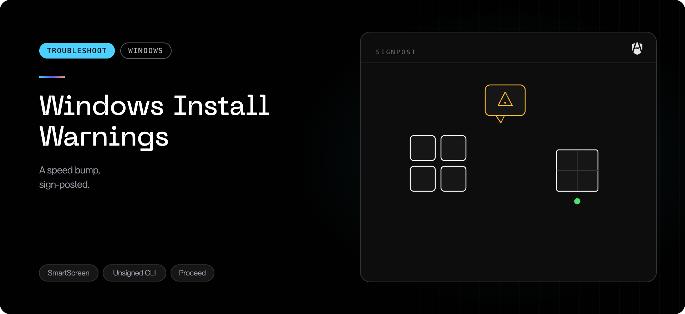

An installer reporting success does not prove the device enrolled or that every
security component is active. Identify which stage failed before reinstalling.

## Installed but not enrolled

### What it means

AgenShield has installed, but the device has not completed registration with your
organization. A tokenless MSI or unattended bootstrap needs a **separate machine
enrollment policy**. If that policy is missing, incomplete, assigned to the
wrong devices, or points to a revoked campaign, the software can install without
the device appearing in the Frontegg Portal.

Older MSI enrollment handoffs also used a language-dependent permission check.
On a non-English Windows edition, an MSI-property install could skip writing the
enrollment details rather than store a token in an unverified location. Do not
assume that a newer MSI has been qualified on your Windows language edition
merely because the install completed. Use managed enrollment policy for fleets,
and qualify any MSI-property method on the editions you deploy.

### Confirm and recover

1. Run `agenshield status` and check whether **Cloud** identifies the expected
   organization and cloud URL.
2. In Intune or your deployment tool, confirm that the **machine** enrollment
   policy applied to this device. `CampaignToken` and `CloudUrl` must both be
   present in the same 64-bit machine policy; do not paste the token into a
   ticket or screenshot.
3. Confirm the campaign is active. A revoked campaign refuses new enrollments;
   removing policy does not revoke an existing enrollment.
4. Repair the policy assignment or use the Windows install command copied from
   the campaign in an administrator-approved PowerShell session. The installed
   service retries enrollment after complete policy arrives.
5. Confirm registration in the Frontegg Portal and receipt of your organization's
   policy, not just a successful installer result.

See [Windows managed enrollment](../troubleshoot/install-succeeds-but-device-never-enrolls.mdx#windows-managed-installations)
and [Windows MDM deployment](../deployment/mdm/windows.mdx) for the supported settings.
For a device in a connected Intune campaign, follow the
[Intune delivery checks](../troubleshoot/windows-intune-device-not-protected.mdx).

## Publisher or signature verification warning

### What it means

Published Windows releases use signed installers. The bootstrap checks the MSI's
release checksum and expected Authenticode signer before installing. A
SmartScreen reputation prompt and an **invalid or missing signature** are not
the same thing: a valid signature does not guarantee a file has enough reputation
to avoid a SmartScreen prompt.

An unsigned development build is not an approved fleet installer. Do not
interpret an old "unsigned installers are expected" instruction as permission to
bypass verification.

### Confirm and recover

Obtain a fresh installer from your organization's campaign or the selected
release. Check it in PowerShell:

```powershell
Get-AuthenticodeSignature -FilePath .\AgenShield.msi |
  Format-List Status, StatusMessage, SignerCertificate
```

Confirm **Valid** and the expected Frontegg publisher, and compare the file's
SHA-256 with the selected release's checksums. A copied file may have a different
filename; use the actual path.

- If the checksum or signature check fails, **stop**. Do not edit the script to
  disable the check, install a different certificate, or use **Run anyway** to
  work around it.
- If the signature is valid but SmartScreen still warns, ask IT to approve the
  verified release through the organization's normal deployment process.
- If IT policy blocks the installer, use the policy-blocked steps below. Intune
  does not make an invalid signature acceptable.

## Blocked by IT policy

### What it means

Releases with Windows policy-blocked reporting can show **Windows policy is
blocking AgenShield's driver** or **Windows policy blocked an AgenShield
installer action** when Windows provides matching blocking evidence. This is not
the same as a generic access-denied, signature, download, or driver-start failure.
An inconclusive result must still be investigated; it does not prove a policy
block or prove that policy allowed the operation.

Reporting is limited to confirmed current driver blocks and matching managed
installation-script blocks. It cannot classify every application-control
refusal; historical or audit-only events are not proof that the current action
was blocked.

The software may be installed while the affected security component is unavailable
or an update action is blocked. Do not treat the presence of the app or an install
marker as proof of active protection.

### Confirm and recover

1. Record the required action shown by AgenShield and the failure time.
2. Ask IT to review the applicable Windows application-control and driver
   policies. In Event Viewer, review **Microsoft → Windows → CodeIntegrity →
   Operational** for driver failures and **Microsoft → Windows → AppLocker →
   MSI and Script** for installation-script failures.
3. Collect an AgenShield diagnostic bundle and share the matching event details
   through your approved support channel. Avoid unrelated event dumps containing
   user or device information.
4. Have IT authorize the exact signed release where appropriate, then retry the
   install or update and confirm component health again.

**Do not disable Secure Boot, memory integrity, application control, or the driver
blocklist to clear the warning.** A Microsoft-attested driver still needs to meet
your organization's allow policy.

## Organization certificate mode is unsupported on Windows

### What it means

When network inspection is enabled for a Windows installation and its applicable
organization policy selects the shared organization certificate mode, AgenShield
reports that this mode is unsupported on Windows. Releases with this warning
surface it as a blocked network-inspection required action.

This warning is conditional: it does not mean that all Windows certificate modes
are unsupported, nor that a device configured without network inspection has a
certificate failure. The affected inspection path remains fail-closed; AgenShield
does not silently switch to a different certificate mode.

### Recover

Contact your IT administrator to choose a supported certificate mode for Windows
and publish the updated organization policy. Installing the organization root
certificate manually is **not sufficient** to make this mode supported. Confirm
that the device receives the new policy and that the required action clears
before claiming inspection is available.

## Update limitations

Windows devices on AgenShield 2026.10.2 or later can be updated from the
Frontegg Portal; this needs an intact installed signed bootstrap. The Frontegg
Portal refuses to update a device on an earlier version and names the minimum
version; use a verified signed MSI through your normal IT deployment process to
reach 2026.10.2 or later first.

For supported releases:

- Where IT enforces `AllSigned`, unattended script execution requires the
  verified script publisher to be machine-trusted. Authenticode validity alone
  is not publisher-trust authorization: the non-interactive host refuses an
  unknown-publisher approval request and fails rather than waiting for a prompt.
  Ask IT to deploy the verified approved publisher certificate through its normal
  certificate policy; do not disable IT policy or signature verification.
- If an update reports unsafe **legacy installation permissions**, it is refused
  before scheduling, not queued for later. The updater does not take ownership
  or rewrite those legacy shared folders to force the update through. Ask IT to
  restore a secure installation with the reviewed signed installer or approved
  administrator remediation; do not suppress the security check. This concerns
  a reported unsafe legacy layout, not routine permission changes on normal
  folders created by the current installer.
- Both IT-forced and accepted interactive updates use the verified Windows
  installation path. The update must survive the background service stopping
  during MSI replacement; do not kill the install just because the service
  temporarily disconnects.
- The bootstrap refuses unsigned, wrongly signed, or checksum-mismatched MSIs.
  It also does not downgrade an installed version that is equal to or newer
  than the requested target. Changing a version pin is not a downgrade tool.
- `3010` means the installation requires a restart. It is not evidence that
  the restart occurred; arrange it through IT and recheck protection afterwards.
- A scheduled action or a newer-looking version alone does not prove the update
  succeeded. If an interrupted action has no confirmed result, investigate the
  reported failure or unknown outcome before retrying.
- Installation and updates need access to the selected release download service.
  An offline MSI deployment avoids the bootstrap download, but enrollment and
  policy receipt still require cloud connectivity.

The update log is `%ProgramData%\AgenShield\logs\upgrade.log`; unattended
installation logs are under `%ProgramData%\AgenShield\logs\install`. Ask IT to
collect protected logs where administrator access is required.

## When to escalate

Contact support if a valid machine policy and active campaign still do not enroll,
if release verification fails, if a required action remains after IT approval, or
if an update outcome cannot be established. Include the AgenShield version, Windows
edition and language, deployment method, failure time, and a
[diagnostic bundle](../troubleshoot/collecting-diagnostics.mdx). Never include a raw
campaign token or an unredacted token-bearing policy export.
